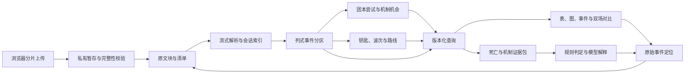

# LMonitor 战斗日志分析系统设计

架构评审稿 · 2026 年 11 月 23 日

本地实现、数据库和验收边界见[日志分析系统复核](docs/日志分析系统复核.md)。

### 当前入口与运行方式

登录后从站点顶部「日志分析」进入。独立上传页处理浏览器本地分割和续传，关联角色页管理 WCL 来源，两者汇入同一日志库。Dashboard 提供上传回收与公开角色名额管理。团队分析册可接入自己和队员贡献的多份报告，按副本、构建号、难度／层数、词缀分组；成员可阅读对应的场次、事件与模型意见。整份原文下载及单报告模型请求保留给上传者。撤销成员时同步移出其在该册的贡献，其他授权路径分别生效。

活动总览可进入多场对照或单场工作台。伤害、承伤、有效治疗、过量治疗、施法、打断和死亡使用同一筛选契约，支持按来源、目标、技能、专精、职责、时间窗、宠物归属及敌方第 N 次读条分组或对齐。跨场速率按总量除以所选时长之和。起点缺失、重复文件和疑似同视角重复场次显示排除原因。角色页提供施法、光环区间、血量、资源及按地图分层的位置样点。大秘境可选一把钥匙或其中的推断交战波次；目录中的首领尝试保持独立。

打开活动目录中的战斗即可使用数据浏览器。先选指标，再选择统计单位、行维度和时间范围。左侧可按名称或编号查找筛选值。交叉表支持任选两个不同维度，点击单元格可按相同条件查看逐条事件。明细表最多可将四个分组加入同一纵轴的趋势图。拖选开怪时间轴会同时重算图、表和事件。团队分析册的同组跨场查询使用相同操作，事件依次按报告、场次、原始行排列。查询状态保存在页面地址，可通过浏览器后退或复制链接恢复。

在日志库选中一份或多份日志后，先进入战斗目录，再选择具体场次或同组对比。勾选场次后可以看合计和逐场指标；选择钥匙全程时，其子首领只参与一次合计。单场切换保留指标、角色、技能、相对时间窗等通用筛选，波次与分页随场次重置。同一浏览器标签页内可从日志库恢复上次视图，恢复键绑定账号、报告及发布版本。

「角色对比」允许两侧分别指定上传文件和场次，也可仅选两名角色，自动在当前账号可读取的报告内择优。角色按 GUID 识别。选样使用含已确认召唤物的整场 DPS 或有效 HPS，拒绝缺少时长或数值不完整的排名。自动组按构建、活动、难度或层数、词缀和结果区分；地下城首领同时绑定所在钥匙条件。各组先独立选取两侧的最佳样本，在共同组中优先最高的较低一侧速率，再看另一侧。两份指定文件没有共同组时提示原因，并停止计算对比结果。结果可固定场次，切换七种明细指标及开战对齐分桶；每个角色技能数值均可打开对应原始事件。新版索引随发布预计算角色伤害与治疗，旧索引直接读取事件。

团长可勾选开荒首场、末场等指定尝试保存为对照，也可留空，让查询纳入之后加入的同组场次。指定场次按原文件和起始行定位。移出报告或撤销成员后，重开查询会重新校验可读范围，并提示排除数量。

机制工作台支持读条与打断／完成的配对，以及按活动组配置「施法后受击」和「光环后驱散」规则。结果逐轮链接到触发及响应行。死亡、单场机制与跨场规则支持匿名证据包和有引用的 AI 解释，结果绑定报告版本或比较样本指纹。跨场模型调用要求本次纳入的报告均属调用者且调用者为册主。可读证据无需启用模型。

**部署顺序。** 执行 `python manage.py migrate` 并更新静态资源。迁移 `0294_merge_combat_and_gear_jobs` 汇合日志分析与辅助配装两条迁移链。Web 与 LMonitor 后台使用相同的主库和私有冷热目录。已发布的旧报告继续可读，上传者在报告页点「从私有归档重建分析索引」生成新版。上传完成后，服务在当前进程内校验完整摘要并完成索引后才切换已发布指针。解析失败保留上一版本的读取路径。

**存储与队列。** 默认热卷为 `var/combat-logs`；冷卷由 `COMBAT_LOG_COLD_ROOT` 指定，默认与热卷同级。迁至独立低价磁盘时显式配置冷卷。冷归档使用一份 ZIP64 包，包内每个不同摘要对应独立 gzip 块，并包含顺序清单。复核整文件长度与 SHA-256 后才释放热原文块；索引保持在线，冷档可直接查证和下载。回迁后保留已校验的冷包作为副本，容量预算须计入。可用以下命令预览及执行，示例中的「报告编号」用实际 UUID 替换：

```text
python manage.py combat_log_storage --tier cold --older-days 30
python manage.py combat_log_storage --tier cold --older-days 30 --apply
python manage.py combat_log_storage --tier hot --report 报告编号 --apply
```

浏览器本地原文件默认最多 2 GiB，由 `COMBAT_LOG_MAX_SOURCE_BYTES` 设置。上传时只发送所选场次及必要上下文，每片 512 KiB。服务端按场次未压缩字节执行 `COMBAT_LOG_MAX_BYTES` 校验，账号字节配额默认 10 GiB，磁盘保留空间默认 256 MiB。账号配额、保留空间和热卷目录分别由 `COMBAT_LOG_ACCOUNT_BYTES`、`COMBAT_LOG_MIN_FREE_BYTES` 和 `COMBAT_LOG_ROOT` 设置。暂停上传只释放尚未收到部分的配额；既有分片继续可用。上传完成的事务提交后，Web 进程按需解析索引，队列处理完毕即退出该线程。首次发布时按该账号当前策略复核名额，成功后才回收旧文件。现有 LMonitor 存储维护周期负责到期清理、文件删除重试及中断解析的恢复。需要自动暂停长期未完成的上传时，可用 `COMBAT_LOG_PAUSE_IDLE_DAYS` 指定闲置天数。并发准入由主库协调，同账号同时解析一份。排队数据、已发布指针和有序分片清单在主库，备份应同时包含主库、冷热卷及索引。

**当前边界。** 物理存储使用私有文件卷，事件查询使用版本化 SQLite 与发布时生成的活动摘要。下面的对象存储和列式数据仓库是规模升级设计。多记录者重叠时按规则选择视角，未执行逐事件跨记录者融合。基于日志的波次和站位图是观测与推断；地图采样缺失、未知数值布局和未闭合的机制窗口在相应视图分别处理。

## 1. 系统范围与核心决策

团长想回看整晚开荒中反复减员的机制，队长想比较同一副本两把钥匙损失时间的位置，玩家想核对某次死亡前受到的伤害和治疗。这三个问题需要不同的统计单位，却都需要能回到同一条原始记录。建议把系统建设成可长期保存原始证据、按需重算规则、支持跨报告分析的后台服务。

| 决策 | 选择 | 对用户和工程的影响 |
| --- | --- | --- |
| 上传、报告与活动各自建模 | 一次上传保存一个源文件；报告是可授权的来源集合；活动、尝试、钥匙与波次是来源上的逻辑区间 | 一份文件可包含多晚、多个副本；一次活动可引用多个文件；跨报告查询无需复制原文 |
| 长期数据与热查询分开 | 私有对象存储保存可独立解压的原文块和版本化列式事件；关系库保存权限、目录、任务与发布指针；本地缓存热点分区 | 可只恢复某一场，可重新解析一个受影响的版本。SQLite 可用作本地实验及缓存；跨报告明细经统一查询服务执行 |
| 两种领域模型 | 团本以首领尝试和机制轮次组织；大秘境以一整把钥匙和交战区间组织 | 一套事件可回答两类问题；两者的时间分母、进度、比较对象与首页不同 |
| 图、表、事件、AI 共用查询契约 | 同一份权限快照、筛选、归因、区间与规则版本决定结果 | 点击趋势峰值、透视表单元格或 AI 结论，可还原相同事件集合 |
| 可逐步部署 | 首期复用 Django、后台权限和 LMonitor 既有定时维护，流式解析、对象归档和查询执行各有边界 | 试点可在单机或共享存储运行；积累真实负载后单独扩展解析和查询算力 |




**WCL 提供的公开参照。** WCL 的公开 GraphQL 将报告主数据、战斗集合、事件、表和图放在 Report 下，查询可限定场次、时间、角色或目标等条件。ReportFight 同时表达首领阶段转换、钥匙层数及官方完成时间；地下城包含带时间、敌人和地图信息的 ReportDungeonPull。这些公开接口支持下面的领域划分。其内部存储、分片及计算引擎没有作为本方案依据。[Report](https://www.warcraftlogs.com/v2-api-docs/warcraft/report.doc.html) · [ReportFight](https://www.warcraftlogs.com/v2-api-docs/warcraft/reportfight.doc.html) · [ReportDungeonPull](https://www.warcraftlogs.com/v2-api-docs/warcraft/reportdungeonpull.doc.html)

## 2. 三种切分与上传协议

| 切分 | 边界由什么决定 | 建议试点粒度 | 断点及校验单位 |
| --- | --- | --- | --- |
| 浏览器上传分片 | 先选择场次，再按该场次原文字节偏移分片，可跨行 | 当前每片 512 KiB，尾片可短，片数按各场次分别向上取整 | 场次上传会话、片号、长度、片校验和 |
| 原文归档块 | 解析端读到完整行后封块，可跨首领；保留原始换行、编码与字节顺序 | 先测 4、16、64 MiB 未压缩块；块可并入较大对象，清单记录压缩后范围 | 块摘要、原始字节及行号范围、编解码版本、对象位置 |
| 逻辑活动与战斗 | 钥匙与首领标记、地图上下文、单位交战及版本化规则 | 任意时长，允许嵌套、重叠及残缺 | 会话和源区间；每个区间记录开始及结束依据，可跨多个物理块 |

**上传协议。** 浏览器创建上传会话，声明大小与文件信息。服务端校验账号权限和预留空间，选择片大小，返回会话标识、过期时间、已接收片清单及有限期写凭证。浏览器按需读取文件并有限并发上传；刷新后重新选择本地文件，可查缺片再续传。文件名、大小、修改时间只用于找到候选会话；复用前核对分片摘要。重复提交同片同摘要返回成功，冲突时提示重新选文件。上传对象使用服务端分配的键，签名限定片号、对象与有效期。支持私有直传，也可在无对象存储的试点经 Django 流式转存。

完成请求携带有序片清单。服务端验证缺口、重叠、各片实际长度、总长及存储端校验，按序读取并验证整文件摘要；多段上传的 ETag 不作为整文件内容摘要。完成请求可安全重放。先登记可恢复的「待校验」工作，再异步归档与解析；完成响应丢失可按会话查到同一来源。未完成会话过期后中止存储侧分段并释放预留。发生额度超限、摘要冲突、浏览器中断或存储不足时分别反馈。首期接受正式服原始文本；若支持 gzip/zip，须另设解压字节和文件数上限，先流式解包后建立原文索引，偏移始终指向解包后的源字节。[多段上传及校验语义](https://docs.aws.amazon.com/AmazonS3/latest/userguide/mpuoverview.html)

**本地实验。** 从固定提交流式读取一个 9.0.2 原始文件，逐行保留换行，在加入下一行将超过 4 MiB 时封块，各块独立用 zlib 级别 6 压缩。输入 76,979,002 字节、272,367 行，输出 19 块共 5,483,125 字节；18 次具备起止标记的首领尝试里，7 次横跨物理块。文件摘要为 `72b3ee25ac51b0e08c2b250e71171ec4c22ab6069df961e946031105c1cfa2bf`。这组数据用于回归分块、重组与战斗定位；生产压缩率及当前版本字段宽度另测。[固定版本样本](https://github.com/rp4rk/WoWP/tree/6138a195ba5a481bcacbab4a0bbe29e8c933b425)

## 3. 从源文件到可分析的活动

**解析顺序。** 接上个传输片剩余的字节，按完整行解码 → 识别会话与格式 → 规范化事件和标识 → 建活动与参与者索引 → 计算可重建的派生指标 → 校验并发布。逐行保留原始起止偏移。阶段一顺序扫描一次即可产出会话、活动边界、原文清单及规范化暂存；后续工作按会话和时间区间并行。长光环、宠物归属、战复和未完成读条可能跨工作分区，边界传递有效状态与最后处理的事件序号。重放同一输入必须得到同样的事件键、边界和数值。

**标识与分段。** 每条观测由源摘要、字节偏移、派生子序号定位；同毫秒事件保留行序。会话保留原时间、时区依据、项目、构建号、格式及高级日志开关。首领起点创建活动尝试，按当前副本与首领配对结束标记；新开怪到来时仍未闭合的旧尝试按「终点缺失」封存。仅收到结束可记结果，起点与时长未知。钥匙单独配对，保留原始起止和官方结算，重复或孤立的结算保留证据并标异常。跨午夜正常推进；回拨、掉线、切换地图或会话重启，保留覆盖缺口。查询统一使用半开区间；结束标记所在行明确纳入尝试。

**跨文件和多视角。** 支持把多个文件组织成一份团队报告。完全相同文件按租户及摘要复用；持续增长的日志可验证公共前缀，增量处理新增后缀并重开上次截断的区间。文件轮转后用角色、地图、首领、时间邻近和唯一事件序列建立拼接候选。多个队员同时录制属于多个观测视角。首期显式选择主视角，其他记录作为补充或独立对照；可靠匹配前不自动相加。后期校准时钟偏移与漂移，用施法者、目标、技能、事件类型、时间和数值匹配一对一观测，保留来源映射、冲突及置信依据。同一毫秒的相同跳伤可能真实发生多次，禁止仅按时间和技能去重。跨报告的统计按已确认的活动身份去重；疑似重复显式提示，默认选一侧。角色私有 GUID 用于授权范围内关联，名称仅供显示。

| 场景 | 团本 | 大秘境 |
| --- | --- | --- |
| 单场最小可读对象 | 一次首领尝试，可进一步框选阶段、转阶段或第 N 次机制 | 一把钥匙，可进入某次首领尝试、某波小怪或任意时间窗 |
| 从何处切入 | 团队 → 活动夜 → 首领与难度 → 尝试 → 阶段或机制轮次 | 团队 → 赛季与副本 → 钥匙 → 全程时间轴 → 首领或波次 → NPC 实例与读条 |
| 单场结论 | 击杀或失败、最佳进度、首死、减员顺序、减伤覆盖、阶段耗时 | 完成或中断、官方用时与记录跨度、全程及交战 DPS、死亡集中区、危险读条与打断 |
| 多场比较 | 同首领同难度；按队伍、构建号、阵容、到达阶段和机制次数分层。显示机会数与样本数 | 默认同副本、赛季、层数和关键词缀；展示队伍与路线差异。可放宽层数并标出分组，按敌方组成、楼层及首领锚点匹配 |
| 跨晚或跨周 | 拉出开荒曲线、首次减员分布、重复失误机制、各阶段通过率。进度优先用可靠阶段或首领血量采样 | 比较同路段战斗时间、赶路、战斗外停顿、死亡与回跑。记录缺口单列，重叠的死亡与战斗耗时不能简单相加 |
| 可靠性边界 | 到不了第三阶段的尝试不进入三阶段机制分母；已指挥放弃或连续收尾死亡可另建筛选，保留原值 | 首领带小怪、连续拉怪和跨楼层无法总是唯一分波。用战斗区间并集计算交战时长；可手动修订波次，保存原分段与修订版本 |

**小怪分波细则。** 先按参战队员与敌方实例的有向交战记录生成区间，再依据共享敌人、重叠交战与脱战空档合并；空档阈值随分段规则版本配置。残留持续伤害、远程引怪和死亡后释放产生的孤立事件保留。一个敌人可显示于多个战术标签，汇总时每条事件只贡献一次。MDT 对照按赛季、地图层、NPC 与坐标匹配；多候选、坐标缺失、版本不同均标明。兵力须有经核对的版本化 NPC 权重和特殊规则；无法核对时展示实际击杀组成。

**分段反例。** 上述实录有 3 条钥匙开始和 6 条结束。逐行核对后，三个副本均在开始前 9–19 毫秒各出现一次层数和耗时均为零的结束标记，之后才有带层数与耗时的结算。该样本的验收值是三把可配对钥匙，另有三条孤立标记。仅按结束事件计数会多出三把。保留原行，可在其他版本出现类似标记时重新核对。

## 4. 长期存储、索引与恢复

| 层 | 长期保存单位和数据 | 典型读路径 |
| --- | --- | --- |
| 私有原文 | 不可变压缩块或打包对象，清单保存原始顺序、字节区间、行号、块摘要、压缩后位置；对象键无需包含角色名 | 任一证据链接经权限校验，通过源清单定位块，范围读取或恢复后返回所需几行。按序解压重组可复核整文件 SHA-256 |
| 规范化事件 | 建议采用 Parquet，按租户隔离，按来源会话与时间顺序写行组；清单记录起止时间、事件族、可用列、构建号及版本。小文件后续合并 | 从目录获得源及时间段，利用行组元数据排除无关范围，只读查询所需列。死亡常用目标索引或小型事件窗口；高频光环查询可增建区间索引 |
| 长期事实与摘要 | 尝试、钥匙、波次、阶段、机制机会、死亡、队员及技能事实；存可加分子与分母、覆盖范围和样本数 | 报告首页、跨周趋势及机会率查事实表。跨报告高频聚合按租户、赛季、副本、难度等键分区；名单、临时筛选走事件查询 |
| 元数据与权限 | Django 主库保存来源、上传进度、报告成员、来源引用、产物版本、数据温度、任务、索引及审计；目录项不随本地缓存驱逐而丢失 | 报告目录、授权、读取快照和判断是否需要回迁 |
| 热缓存 | 最近活动的列式分区、死亡证据窗口、固定分辨率趋势和查询结果，按权限域、源版本、查询指纹寻址 | 命中直接返回；失效可从列式事件与事实重建，支持按活动预热 |

原文清单与列式清单分别版本化，重整行组或更换压缩方式后仍以源字节定位证据。不要按技能、玩家和每个波次各写一个对象。先按样本评估行组大小和谓词选择率，批量打包小文件；同一玩家跨整场的查询由索引裁剪或下推聚合完成。建议试点用支持 Parquet 谓词下推的嵌入式分析引擎（候选 DuckDB），交互查询由独立进程执行。若实测高并发跨报告扫描成为瓶颈，可将热点事实同步到 ClickHouse 等分析库；两条路径必须通过同一查询契约和一致性验收。[Parquet 文件组织](https://parquet.apache.org/docs/file-format/)

**温度与保留。** 试点策略可用「近期 30 天热明细、赛季内温明细、跨季冷原文及可检索摘要」。三层迁移依据最后访问及赛季归属，保留周期独立配置。冷层若需整对象解冻，按可接受恢复粒度打包并记录恢复单位，前台显示「摘要可读／事件待恢复」、预计取回量和状态。多次申请恢复同一分区共享作业，有成本预算、临时热副本到期和取消机制。归档清单、已发布事实、规则版本和证据定位长期可读。若团队选择原文到期删除，则提示精确截止日期，并将重算和原始行能力标为不可用。团队可固定重要活动；按权限查询与删除应覆盖冷热副本、导出结果和 AI 证据缓存。

**发布与删除。** 每个版本绑定输入清单、解析器和规则版本、数据覆盖、分区摘要。工作进程领取带代次的租约，先写暂存对象，校验计数和摘要，再用关系库事务条件切换发布指针。读者在请求开始时固定版本。复算一条机制规则只重建相关机制事实；解析字段发生变化才从受影响构建号的原文重放，先运行差异报告。删除报告立即撤销权限并取消待发布任务；源文件被多份报告引用时根据租户内引用和读取租约延迟回收。独占内容、冷副本、缓存及派生结论按删除策略清理，备份按独立到期策略轮换；恢复备份后重放删除台账。每季度抽取归档进行从清单到单场查询的恢复演练，记录实际 RPO、RTO 和取回费用。

**容量怎么估。** 设日新增去重原文为 D，原文及列式的体积系数为 R、E，近期开销为 H，保存天数分别为 Tr、Te、Th。基础容量约为 D × (R×Tr + E×Te + H×Th)，另加摘要、对象元数据、副本或纠删码开销、备份、暂存和重算峰值。示例输入取 50 GiB/日，R=0.18，E=0.30，两者保存 365 天，H=0.12、热缓存 30 天，基础数据约 8,940 GiB（8.73 TiB）。这些是预算假设；历史样本的单次压缩结果不能替代当前版本的容量基准。上线前按团本夜、单把钥匙、多把混合、截断大文件分组测 P50/P95，记录对象请求数、冷恢复字节、热缓存命中、带宽、解析速度、临时空间及每团队月成本。

## 5. 多维分析与页面如何共用同一份答案

查询先确定**可见的活动集合**，再选**指标、维度与窗口**，最后选**表、图、轨道或事件**。比较器保存两侧各自的查询，再声明对齐方式。面包屑要保留分母及样本，如「团队 A／本周／首领 X／英雄／到达二阶段 8 场／第二次点名」。切到其他视图或复制团队私有链接后仍能恢复所选范围。

| 维度 | 可组合条件 | 展示及典型下钻 |
| --- | --- | --- |
| 样本与进度 | 团队、报告集合、日期、活动类型、赛季、补丁、难度、层数、词缀、阵容、击杀或失败、最低阶段 | 样本表、开荒进度曲线、钥匙散点；点样本可查看纳入理由和排除项目 |
| 时间与机制 | 全场、任意窗口、阶段及轮次、技能第 N 次施放前后、光环存在期间、玩家存活时段 | 同步趋势图、施法与减伤轨道、机制机会矩阵；框选或点击图钉更新表与事件 |
| 参与者 | 来源或目标、玩家／NPC／宠物、队伍职责、职业专精、NPC 模板或具体实例、宠物归属 | 来源 × 目标矩阵、玩家技能树、受伤来源分解。点一个格子得到同一条件的事件 |
| 事件与数值 | 直接／周期、伤害类型、有效／过量、吸收、施法结果、打断、驱散、战复、资源变化 | 伤害、承伤、有效治疗、资源、光环、施法、死亡视图；技能可追到逐跳与多目标命中 |
| 空间与路线 | 地图层、NPC 组合、波次、位置样本及覆盖率 | 地图叠加、波次清单、选定时刻的位置回看。采样间隔过大时断线，地图映射缺失时仍可看时间轴 |

**查询请求实例（示意）。** 团长选择「同一团队、同首领同难度的八次尝试，第二阶段第二次点名前 3 秒至后 8 秒，分别看每个目标的有效承伤」。请求至少包含授权后的活动集合、已发布版本、锚点及出现序号、相对窗口、有效承伤指标、目标和尝试两个分组维度、宠物归属与完整度策略。服务端返回八场中有几场实际出现该锚点、各自覆盖时段、按目标聚合的值、规则版本和可展开的证据定位。未到达、锚点未知、出现且承伤为零分别显示。点中一人一场后，只查该格子的事件。

**执行路径。** 用户选择条件 → 服务端将允许的筛选编译为受限表达树 → 固定授权报告和各产物版本 → 将锚点展开成每场区间并取区间并集 → 优先命中同一粒度的完整事实，否则裁剪列式分区 → 局部聚合后合并 → 产生游标和可复现的下钻令牌。表、图、事件共用此流程。查询键包含权限域及修订代次、指标定义版本、参数和来源清单；分页游标包含稳定排序的时间、源与事件序号。裁剪到分区边缘的时间桶从明细重算。跨数百场或冷分区的大查询先报价扫描字节，交互阈值外转异步，可取消并保留查询定义。权限撤销后重验所有缓存和私有链接。

**图表的统计语义。** 区间总 DPS 为有效伤害总和除以所选完整区间时长之和，典型单场表现可另给每场 DPS 的中位数；两种值分别标名。阶段通过率分母是到达该阶段且边界完整的场数。机制失败率的分母是符合资格且有足够观测的机制机会数。增益覆盖按目标可观察时间计算，先合并重叠区间。跨场给出分布、分子分母、可用样本和排除数；不同难度、补丁或阵容默认分层。幸存者偏差、成功样本偏少和时间窗未对齐都能在样本面板看到。用户可保存条件、钉住某类事件并叠加到时间轴；一期提供有类型的筛选表单，以后可加入受限表达式编辑器。

**导航契约。** 报告库管理上传与权限；团队分析页选择跨报告样本；团本活动页列首领、每次尝试和最远阶段；钥匙页先见全程和波次；战斗工作台上方始终保留活动、所选时间与对齐锚点，下方切换统计表、趋势、轨道、事件或地图。死亡卡、机制卡、AI 对话和导出的分析链接均落到工作台的具体时间窗。支持从证据页返回原比较和筛选，避免每次重新找场次。加载时分别展示索引就绪、待恢复、部分覆盖与无符合条件事件。

## 6. AI 复盘是一个可核验的分析流程

建议先实现三个可调用的能力：从任意死亡生成证据卡、从同一种机制生成逐轮复盘、用自然语言提出跨场问题并得到可编辑查询。每项能力都能独立返回结构化结果。模型负责提出和解释有证据的结论，数值计算、事件匹配、机制规则和权限由系统执行。

### 6.1 从死亡回看扩展到减员链

1. 从已确认玩家死亡的事件出发，默认取前 10 秒及极短的死亡后窗口，允许扩展至 30 秒或上次复活。读取本人血量采样、逐次伤害与治疗、吸收、减伤光环、驱散、战复和同窗首领读条。所有血量均核对采样实体，时间序列标注采样空洞、记录缺口和同毫秒顺序。前序治疗也进入时间线。
2. 规则提取直接致死候选、短窗爆发、多跳持续伤害、承伤高峰、已记录的减伤覆盖和团队同时受击。结合生命上限、过量伤害、吸收和同一命中标识交叉核对，同一事件只计一次。候选冲突时列出各项依据。缺少技能冷却、距离或治疗者视野的可靠记录时，对相关能力的判断保留为未知。
3. 关联机制轮次及同期的其他死亡，用共享技能、同次施放和目标集合形成「同一轮多人减员」候选；时间接近只作为检索线索。分别展示首个可观测异常、首死、后续死亡和团灭收尾。团队可以比较「紧跟首死的连锁减员」与「多名玩家同吃一击」。
4. 输出卡片含事实、证据、可检验解释、反证或缺口、可操作的下一步。例：「两次持续伤害命中间出现一次有效治疗；第二跳后记录死亡。该窗口缺少完整的个人减伤状态，无法判断当时能否开启减伤。可对照本场同机制的另一名目标。」点击每句话应落到原始行、时间窗或统计格。该例为交互示意。

### 6.2 机制复盘需要版本化的机制规则库

每条规则保存游戏构建范围、地图、首领或 NPC、难度、触发技能及别名、机会起点、目标资格、窗口结束、预期可观测响应、成功或失败的证据、豁免条件和已知盲点。例如「危险读条」以具体敌人实例的一次施法为机会，用成功打断及对应读条关联判定已打断；若读条完整成功，只能确认其完成。是否应打断还需该难度的可打断标记和队伍策略。点名换位需要可靠坐标与地图变换；站位不可见时输出受击和光环结果。

规则可引用已有技能本地化、冒险指南或 MDT 信息，但每条判断要有来源和正反样本。AI 可以从反复共现的施法、光环、伤害序列提出待审规则，交由熟悉副本的人确认后才进入正式规则库。版本升级后用旧新规则并行计算，保留修订人、规则变化与受影响报告。

**机制机会表是关键派生产物。** 一条记录对应「某次尝试／某次施放／某个有资格的目标」，有开始、截止、响应、结果、覆盖质量、证据事件及规则版本。群体机制同时保存团队级机会，防止把一次全团机制当成二十次独立失败。目标离场、死亡、免疫、规则发生变化、日志缺失各有可追踪原因。界面横向排尝试、纵向排轮次，点单元格查看该轮完整时间线；成功、失败、未知、未到达四种状态分别展示。

**示例输出（虚构数据）。** 八次尝试中，五次到达二阶段第二轮；其中四次完整记录点名至伤害，另一次日志在中途截断。四次完整机会中两次发生已定义的爆炸命中，可报告为「2/4 个可判定轮次发生爆炸，另 1 个轮次未知，3 次未到达」。再比较成功与失败轮次中驱散、光环消失和伤害的先后。若玩家位置覆盖不足，保留「站位原因未知」。下次活动关注同一规则，自动比较可判定机会及命中次数；调整策略的效果要同时展示难度、阵容与样本差异。

### 6.3 可交互的分析，而非一次性摘要

| 用户提问 | 系统执行 | 返回与验证 |
| --- | --- | --- |
| 「今晚最值得解决哪个机制？」 | 将重复出现的可判定失败按影响的尝试数、直接相关死亡数和出现机会排序；列出样本及缺口 | 至多三条优先项，给出失败与成功各一个对照窗口；允许切换按频率或减员影响排序 |
| 「同副本这把慢在哪？」 | 匹配同层同词缀的可比钥匙，按首领或可靠的敌方组合对齐；将战斗、可观察的非战斗耗时和未知区间分开 | 段落耗时差、匹配覆盖率、路线差异；死亡可能与该段耗时重叠。回跑损失仅在位置和时间覆盖充分时给出范围 |
| 「首死前如果提前交减伤呢？」 | 在已知减伤比例、伤害类型、叠乘顺序、血量与护盾齐备时，对单个已知命中重算明确假设下的剩余血量 | 标为假设推演，列出输入、适用限制及未模拟的后续攻击；条件不足时仅展示相似的真实成功样本 |
| 「帮我把上周和本周相同机制对齐」 | 自然语言转换为允许的查询字段、样本集合与锚点，把解析后的条件先展示出来 | 可编辑筛选、分母和样本名单；查询可保存为下周复盘模板，团员可逐格质疑结论 |
| 「下一次我要重点看哪一轮？」 | 将用户钉住的机制、观察窗口和可验证指标保存为团队复盘笔记 | 新日志解析后重跑这组查询，分别展示出现机会、未知、结果及样本变化；批注独立于原始记录 |

**执行和治理。** 先用结构化查询得到窗口与对照，再生成小型证据包。包内包含报告授权范围、版本、事件引用、计量单位、规则号、排除项与缺口；仅传达问题所需字段。模型只能调用白名单的只读查询模板，限制扫描字节、回合、上下文和费用，不能提交任意 SQL。角色名默认替换为本次任务别名；日志文字一律当作数据。通过 LMonitor 的服务商配置选择允许处理该报告的模型，无法使用外部服务时仍能生成规则卡和事件页。

模型输出采用固定结构：结论类型（观测／推断／假设）、结论文本、支持及反对证据、样本与分母、未知条件、复核建议。服务端逐项校验证据属于当前快照且可见、时间范围匹配、数值可重算；失败项回退到确定性摘要。推断采用依据等级（直接记录、规则关联、比较提示、证据不足），避免给出无校准的概率。模型、提示模板、查询、规则和证据包版本进入审计。以报告版本、规则、查询和隐私范围缓存，重算或撤权后重新验证。用户可以标注「规则错误」「缺少上下文」「对齐错误」并附反例，形成后续评测集。

## 7. 服务边界、可靠性与 LMonitor 落地

| 服务边界 | 建议接口或任务 | 失败和恢复 |
| --- | --- | --- |
| 上传与目录 | 创建会话、读取已收片、申请片凭证、完成或取消；创建报告、追加来源、设置团队可见范围 | 以会话及幂等键处理重复请求，接收与解析状态独立；账号配额与全局暂存预留同时校验 |
| 解析与归档 | 校验来源 → 原文归档 → 分段及规范化 → 事实计算 → 校验 → 发布 | 心跳、租约、有限重试；磁盘或远端不可用时保留可恢复进度。坏行、未知事件族与整份文件无法读取分开反馈 |
| 分析与对比 | 一份分析请求可选择汇总、图、事件、轨道或比较；返回快照、质量摘要、游标和下钻令牌 | 控制同步扫描量、异步排队公平性和并发，取消任务释放预留；单一私有报告不得挤占站内 WCL 采集预算 |
| 机制与 AI | 提交死亡、机制或跨场问题，查询证据包和生成结果，反馈纠错 | 证据包可复用，推理独立排队；上游超时或证据校验失败仍能阅读完整规则结果 |
| 归档运维 | 清单校验、冷恢复、孤儿对象回收、重算、按团队导出／删除 | 冷恢复不堵塞热查询；清除前检查引用与读租约，完成后核对实际对象数和字节 |

**现有代码接入。** 工具权限由 `botend/dashboard/permissions.py` 注册；借鉴 `botend/services/mythic_composition_jobs.py` 的持久任务，用专属队列领取与续租。现有 `botend/interface/ossupload.py` 包含构造公开 URL 的入口，战斗日志需独立私有对象访问层及分片能力。磁盘准入可参考 `botend/services/wcl_storage_guard.py`，其阈值与日志系统预算分别配置。解析时批量复用站内技能元数据，跨角色窗口可参考现有团本爆发事件代码；模型服务商配置对接 `botend/services/ai_provider_service.py`。生产密钥、目录、迁移和部署在实施阶段配置。

**授权边界。** 来源、团队报告、集合查询与导出分别校验，给团队报告增加来源须具备相应授权。用户选择「与团队分享」后才授予读取；查询执行和打开证据链接时均取可见交集。若比较两侧有活动撤权，提示样本已变化并重新计算，避免旧分母泄露。解析节点只写自己的租约输出，读取通过签名或服务身份授权。渲染玩家文本时转义；维护人员常规诊断只见计数、阶段与错误类别。导出匿名化同时覆盖角色名、服务器、GUID 和嵌入原文。


### 建议的首版对象键与查询契约

| 实体 | 唯一性或版本边界 | 查询需要的索引 |
| --- | --- | --- |
| 来源及原文块 | 租户与文件摘要；来源内块序号唯一。同一块的压缩副本可独立更新清单 | 来源与起始字节、块摘要；两端字节定位即可裁剪读取 |
| 报告及活动引用 | 报告版本引用有序来源清单、所选视角与活动区间；团队活动可引用多来源 | 团队、赛季、类型、地图、难度、层数、时间及逻辑活动标识 |
| 活动与机制机会 | 尝试绑定起止证据与分段版本；机会绑定规则号、施法锚点、目标或团队、轮次 | 首领与阶段、钥匙与波次、规则与结果、玩家与时间 |
| 规范化事件与派生事实 | 原观测键固定；派生行绑定来源集合、解析和统计版本。多观察者来源另存匹配关系 | 来源、时间、事件族及演员字典；热点目标、时间和死亡关联的证据索引 |
| 查询、批注与 AI 结论 | 私有保存查询加可见快照；批注锚定源记录，机制解释指向具体规则版本 | 报告集合、快照、查询指纹、权限版本、证据定位、生成状态 |

建议公开给站内前端的契约为 `POST /combat-log/uploads`、`GET /combat-log/uploads/{id}/parts`、`POST /combat-log/uploads/{id}/complete`、`GET /combat-log/reports/{id}/activities`、`POST /combat-log/query`、`POST /combat-log/compare`、`POST /combat-log/reviews` 和 `GET /combat-log/evidence/{id}`。查询结果包含指标及单位、聚合行、分母、机会数或有效时长、覆盖缺口、版本快照和证据游标。比较请求必须明确给出两侧筛选和对齐锚点。AI 任务返回可轮询的审阅标识，单个结论可定位到证据接口。接口联调同时覆盖无权限、冷恢复中、指标不支持与真正零结果。

## 8. 交付顺序与放行标准

| 阶段 | 用户可验收的结果 | 放行门槛 |
| --- | --- | --- |
| A　数据底座 | 多 GiB 上传断点续传、跨块单场恢复、原文归档与版本清单 | 验证乱序、重复、损坏、尾片、跨 UTF-8 字符、取消、完成响应丢失。源文件重组 SHA-256 一致；跨块首领事件不丢不重；杀死工作进程并重试仍只有一个已发布版本 |
| B　两类活动 | 团本整晚尝试目录、大秘境整把与小怪区间、多文件活动及视角选择 | 历史样本配对 18 次首领尝试、44 条玩家死亡、3 把钥匙；加当前正式服团本夜与混合钥匙实录，覆盖连拉、孤立结束、跨天、截断、同名及多视角重复 |
| C　分析工作台 | 同一条件下切换表、图、轨道与原始事件，单场／跨场比较 | 以同源 WCL 报告核对选定伤害、治疗、死亡、打断与阶段。内部格子合计可按事件重算；有外部差异时列出具体归属或边界。检查框选部分桶、分页同毫秒、样本排除与双侧权限变更 |
| D　AI 死亡与机制 | 首先交付死亡证据卡，再为一个团本首领与一个大秘境危险读条族交付机会表和跨场解释 | 建专家独立标注集，按活动夜与构建号拆分训练示例、调优和盲测。逐项记录机会召回、可判定结果精确率、错误致死归因、证据覆盖、拒答表现与费用；缺失证据和规则冲突专门设负例 |
| E　赛季运营 | 长期保存、冷恢复、团队级趋势、复盘笔记与版本回归 | 完成跨季恢复演练、撤权与删除回放、多租户压力测试、新旧规则差异审阅及回滚。首领机制首发覆盖度和每个补丁的维护工作量可量化 |

**试点指标。** 提议将热单场概要和个人死亡窗口 P95 目标设为 1 秒，热多场查询先以 50 场、5 个并行用户、同源规则为测量档，目标 3 秒；超预算查询返回任务与进度。冷恢复分别测受理耗时、首个可读分区时间和全场完成时间。AI 首批盲评建议覆盖至少 50 个死亡窗口和 30 个机制机会，纳入不完整日志；直接断言必须全部有可解析且有关联的证据。盲评中出现无依据归责或将未知判为失败时，停发该类结论并检查规则。以上是验收目标，尚无生产实测。上线记录硬件、冷热状态、规模、版本、扫描字节与峰值内存。

**第一批开发顺序。** 先取得有使用权限的当前正式服团本整晚、大秘境多把混合、两人同时记录同一次战斗三类样本，能取得同源 WCL 报告的配对留档。并行实现上传与归档，以及本地可重放的事件／机制标注集。第一个端到端里程碑是从一个跨块、跨报告可定位的死亡，打开原文、比较同轮幸存样本，重算后仍能解析旧证据链接，再把该活动移入冷层并恢复演示。这个里程碑同时验证存储、分析与 AI 三条链路。

## 附录　基础事件与计量口径

| 处理项 | 建议规则与界面表现 |
| --- | --- |
| 顺序与边界 | 记录原时间、会话相对毫秒、源行号、字节位置。相同毫秒以源行号稳定排序；首领起止行均可追溯。查询区间统一左闭右开，末尾标记用事件顺序纳入。跨零点、时区偏移、重复版本头、时钟回拨分别处理；无法还原的绝对时间只显示相对时间 |
| 格式覆盖 | 按项目、构建号、日志版本和事件族选字段布局。识别引号内的逗号与嵌套字段；保留未知事件及数量。版本未知时尽量列出可确认的战斗边界，禁用未经验证的数值项；未开启高级日志时说明缺失的血量、位置等能力 |
| 伤害与承伤 | 按已验证布局映射原始量、实际量、过量、吸收、抵抗等字段。统一输出有效生命损失；仅在原始数值确实包含过量时扣除一次。吸收、环境伤害、反射、自伤各列明来源。平砍及其附带记录、增辉辅助归因有单独的配对和计数规则；未验证时只发布已覆盖类别 |
| 治疗与吸收 | 有效治疗、过量治疗和已消耗的吸收分别列出。根据布局将治疗映射为有效值；吸收盾的施放量与实际抵扣量是两个指标。原记录与辅助吸收事件共现时用关联后的单次抵扣；无法归到施放者的吸收可计入承伤明细，归属显示未知 |
| DPS、HPS、占比 | 全场每秒值以完整战斗墙钟时长为分母，框选后用所选区间。大秘境明确区分全程与去除脱战后的战斗时长。贡献占比以当前筛选下的团队有效量为分母；分母为零或起止不明时显示「无法计算」。速率由总量除以总时长计算 |
| 施法、打断与驱散 | 施法开始、成功和命中分别计数；瞬发、引导跳数、多目标命中都保留。成功打断用明确打断事件，记录被打断技能和施法者。仅在可确认施法性质、可打断性和结束时才计算漏断；普通施法成功记录本身不足以判定队伍失误 |
| 死亡与血量 | 只把确认的玩家死亡记录列为玩家死亡；假死、宠物消失等按已验证规则排除或标疑。战复施放和玩家实际重新参战分开记录。血量采样以高级字段中的实体 GUID 归属到本人，图上标出无采样的空档。死亡次数和死亡人数单列；原始计数保留团灭收尾事件 |
| 增益覆盖率 | 在目标、光环及可识别的施放者范围内合并有效区间，再与所选窗口求交；多层和刷新延长各自保留。开场已有光环、移除缺失、玩家死亡都标注边界依据。仅在覆盖足够的区间发布比例，其余给出已观测时长 |
| 宠物、召唤物、辅助伤害 | 保存原始施放者与可证实的归属。默认合并有证据的宠物，同时允许展开；不确定归属单列，合计守恒。辅助贡献维持独立维度，发布前以真实样本检查是否与原始输出重复 |

每份产物保存解析器版本、统计规则版本、分段规则版本及数据质量摘要。质量要细到会话、战斗和指标，例如「这场的死亡记录完整，吸收来源有 3 条无法识别」。可定位的事件需要稳定标识，建议以源文件摘要和源行号为基础，派生记录另加子序号。私有链接使用报告标识和定位信息，访问时仍执行权限检查。
